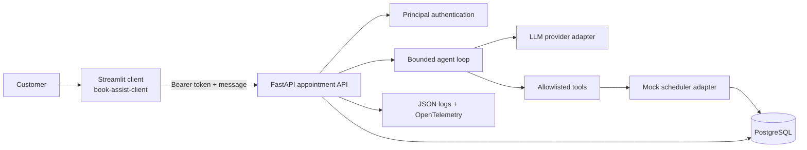
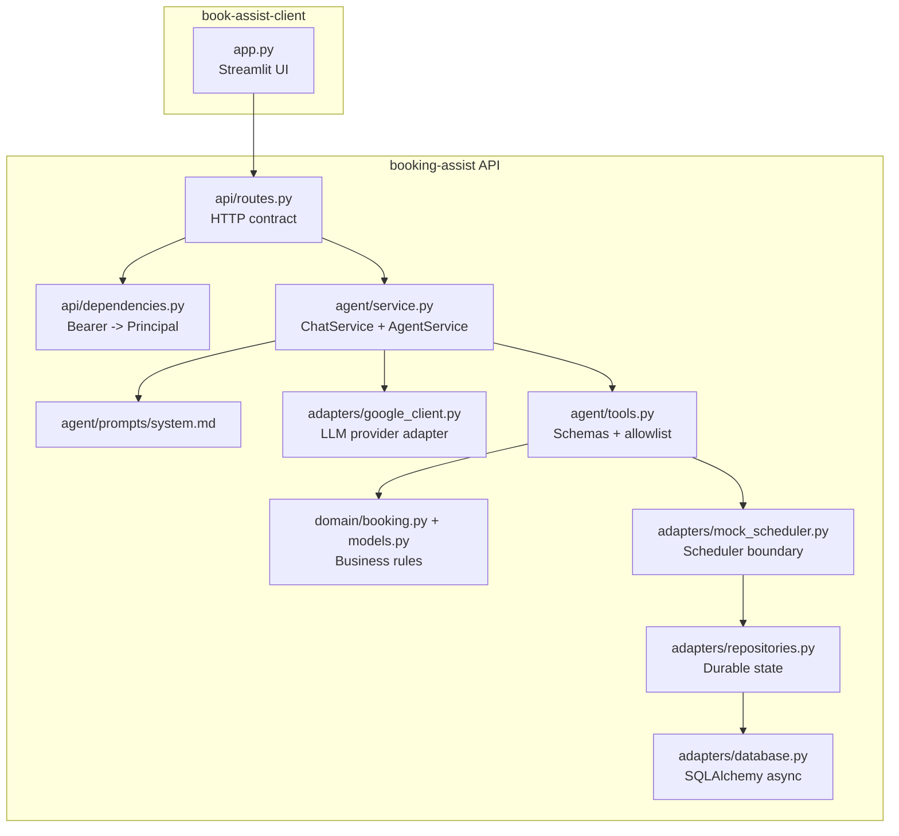
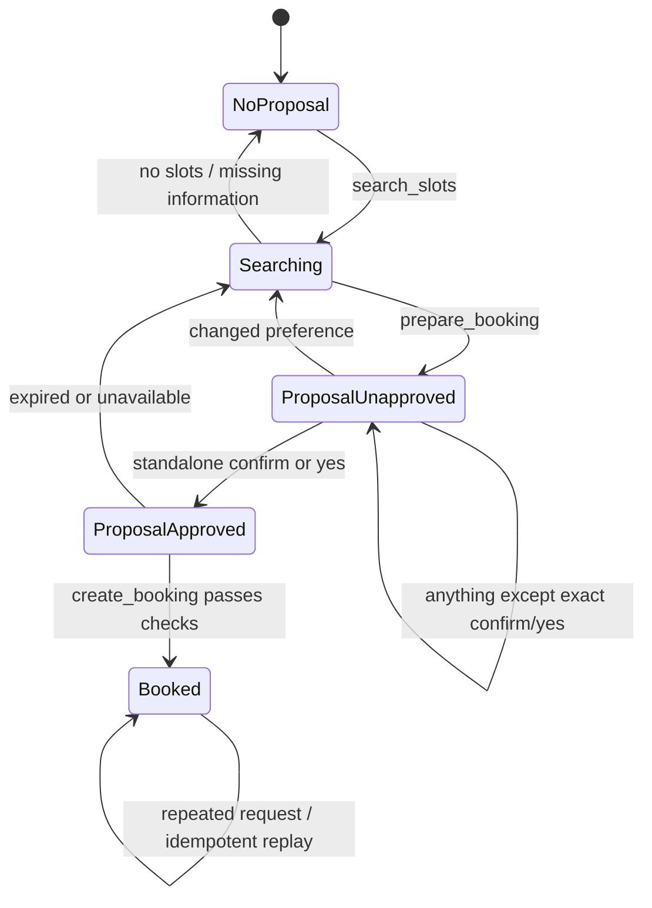
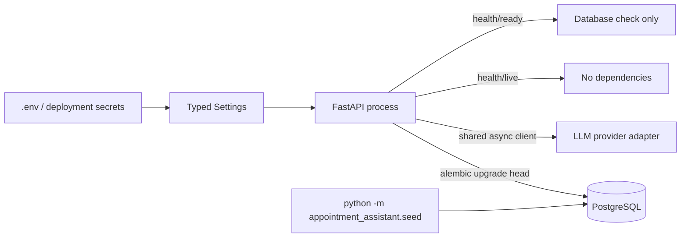

# Architecture at a glance

This is a small, server-side booking assistant. The Streamlit app is only a client; the API owns
provider credentials, conversation state, authorization, confirmation boundary, and booking write.

## 1. System context



Important boundary: the browser never calls the model provider directly. Provider credentials stay
in the API process. The client sends only user text and receives trusted structured
proposal/booking fields.

## 2. Container and code map



| Component | Owns | Does not own |
|---|---|---|
| Streamlit client | Chat UI, session ID, bearer token, rendering receipts | Provider credentials, booking rules, database |
| FastAPI routes | HTTP validation and status codes | Model prompts or SQL |
| Agent service | Bounded model/tool continuation | Authority to bypass domain rules |
| LLM adapter | Provider calls, errors, usage extraction | Principal identity or booking writes |
| Tool dispatcher | Tool allowlist and argument validation | Arbitrary code execution |
| Domain layer | Confirmation, ownership, expiry, booking preconditions | HTTP or provider SDK details |
| Repository | Transactions, idempotency, uniqueness, durable state | Conversation wording |
| Mock scheduler | Synthetic availability and scheduler-shaped interface | Authentication and approval policy |

## 3. One booking conversation

```mermaid
sequenceDiagram
    actor Customer
    participant UI as Streamlit
    participant API as FastAPI
    participant DB as PostgreSQL
    participant M as LLM
    participant T as Tool dispatcher

    Customer->>UI: Find consultation Downtown after 17:00
    UI->>API: POST /v1/chat
    API->>DB: Authenticate, create/claim session, store message
    API->>M: User history + system prompt + 3 tool schemas
    M-->>API: search_slots(service, date, preference)
    API->>T: Validate and dispatch search_slots
    T->>DB: Read available synthetic slots
    DB-->>T: S1, S2
    T-->>API: Function response with call ID
    API->>M: Preserve model call + function response
    M-->>API: Present slots and ask customer to choose
    API-->>UI: Reply + no proposal
    UI-->>Customer: Show available slots

    Customer->>UI: The 17:30 slot
    UI->>API: POST /v1/chat
    API->>M: Continue conversation
    M-->>API: prepare_booking(slot_id=S1)
    API->>T: Validate owner/session and prepare proposal
    T->>DB: Supersede old proposal; create 5-minute proposal
    DB-->>T: Proposal P1
    T-->>API: Exact proposal details
    API->>M: Continue with proposal result
    M-->>API: Display details; ask for confirm/yes
    API-->>UI: proposal P1 + awaiting_confirmation

    Customer->>UI: confirm
    UI->>API: POST /v1/chat
    API->>DB: Record approval for P1 before model call
    API->>M: Continue with approval message
    M-->>API: create_booking(proposal_id=P1)
    API->>T: Validate approval, owner, expiry, availability
    T->>DB: Atomic insert with unique slot/proposal constraints
    DB-->>T: Booking B1
    T-->>API: Booking result
    API->>M: Continue with stored booking result
    M-->>API: Confirmation explanation
    API-->>UI: Trusted booking B1 + booked
    UI-->>Customer: Booking receipt
```

## 4. Confirmation and write boundary



The model may request `create_booking`, but it cannot make the write valid. The repository checks
principal ownership, session ownership, expiry, recorded approval, booking enablement, current
availability, and database uniqueness.

## 5. Data model

```mermaid
erDiagram
    CONVERSATION_SESSIONS ||--o{ CONVERSATION_MESSAGES : contains
    CONVERSATION_SESSIONS ||--o{ BOOKING_PROPOSALS : owns
    AVAILABILITY_SLOTS ||--o{ BOOKING_PROPOSALS : selected_by
    BOOKING_PROPOSALS ||--o| MOCK_BOOKINGS : creates
    AVAILABILITY_SLOTS ||--o| MOCK_BOOKINGS : reserves
    CONVERSATION_SESSIONS {
        uuid id PK
        string principal_id
        datetime turn_claimed_until
        int version
    }
    CONVERSATION_MESSAGES {
        uuid id PK
        uuid session_id FK
        string role
        text content
        uuid client_message_id
    }
    AVAILABILITY_SLOTS {
        string id PK
        string service
        string location
        datetime starts_at
        string timezone
        boolean available
    }
    BOOKING_PROPOSALS {
        uuid id PK
        string principal_id
        uuid session_id FK
        string slot_id FK
        datetime expires_at
        string approved_message_id
        string status
    }
    MOCK_BOOKINGS {
        uuid id PK
        uuid proposal_id FK UNIQUE
        string slot_id FK UNIQUE
        string principal_id
    }
```

## 6. Deployment/runtime sequence



Startup requires a configured provider API key for the real client. Database schema is applied by
Alembic, not by the application. Seeding is repeatable and inserts missing synthetic slots without
overwriting bookings.

## 7. Provider note

The current adapter is one LLM implementation detail, not the product identity. Swapping providers
should primarily affect the adapter and configuration. The adapter preserves provider function-call
IDs when returning tool results so multi-step tool loops remain reliable.

## 8. Documentation sources and limitations

- [FastAPI lifespan](https://fastapi.tiangolo.com/advanced/events/)
- [Pydantic settings](https://docs.pydantic.dev/latest/concepts/pydantic_settings/)
- [SQLAlchemy asyncio](https://docs.sqlalchemy.org/en/20/orm/extensions/asyncio.html)
- [Alembic tutorial](https://alembic.sqlalchemy.org/en/latest/tutorial.html)
- [OpenTelemetry Python](https://opentelemetry.io/docs/languages/python/)

The demo uses a 90-second turn deadline and 55-second per-model-call timeout because live
tool-calling smoke tests showed higher latency than plain text calls. These are configurable
limits, not performance claims. This remains a learning service. Replace `MockScheduler`, validate
real business rules, integrate the organization's identity provider and support/notification
systems, and complete the acceptance checklist before considering a production pilot.
